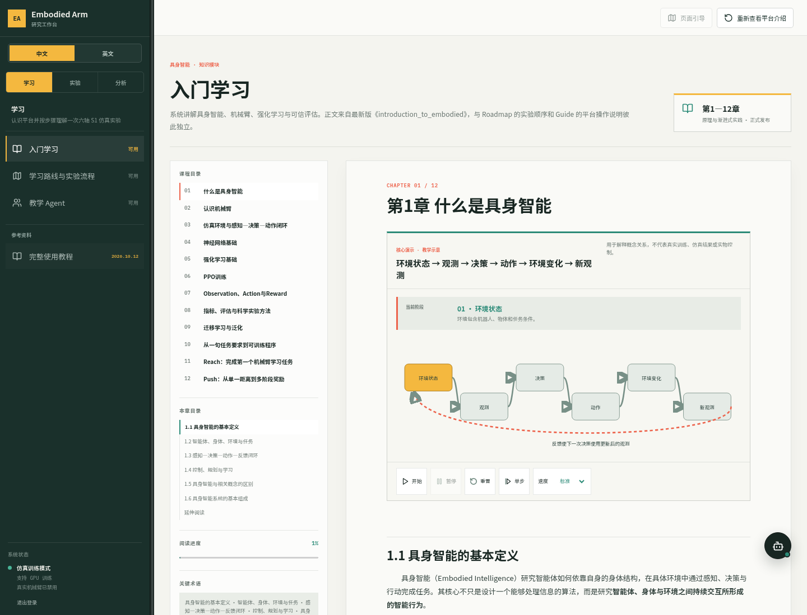

# Embodied Arm Studio

[English](README.md) | 简体中文

面向具身智能课程的机械臂仿真学习平台。阅读教材与交互图示，配置课程实验，运行 S1 仿真，查看训练指标、录像和评估结果。现有教材以中文为主。

- **学习与实践**：课程、教学班、项目工作区，以及支持修改审核与快照的可选教学助手。
- **仿真与训练**：固定控制器演示和 PPO 训练，受任务可用状态、课程权限及部署资源约束。
- **结果分析**：运行历史、指标曲线、录像、模型权重、评估报告及认证制品下载。

## 界面预览

图中为学习界面；仿真实验另提供指标以及实际生成的视频和制品。截图用于展示界面，不作为策略效果证明。

## 从这里开始

| 文档 | 适用场景 |
| --- | --- |
| [快速开始](docs/quickstart.md) | 安装平台并首次登录 |
| [使用指南](docs/user-guide.md) | 阅读课程、配置实验、查看结果 |
| [部署说明](docs/deployment.md) | GPU 要求、远程访问、日常维护及故障处理 |
| [版本下载](https://github.com/Embodied-Arm-Studio-fdu/embodied-arm-studio/releases) | 部署包与校验值；当前需要仓库访问权限 |

Core 模式提供账号、课程和项目编辑，无需 GPU。仿真、训练和实验视频需要 GPU 模式：Linux x86_64、NVIDIA GPU，以及部署者自行合法取得的 Isaac Gym Preview 4 SDK 和完整 S1 资产。取得项目并按安装指南认证后，运行 `python3 scripts/start.py --config .env.team-core`。

仓库和预构建 GHCR 镜像当前均需访问权限与认证；仓库权限和镜像权限分别配置。目前不提供公众免登录镜像安装。镜像固定到 digest，SDK 和完整机器人资产作为外部依赖。具体见[分发声明](NOTICE.md)和[第三方来源与许可说明](THIRD_PARTY_NOTICES.md)。

## 支持范围

任务目录实现了 Push、Reach、Grasp、Lift、Lower/Release、Place 和固定控制演示。能否使用取决于课程项目权限与 GPU 服务；已有实现不等于每项任务的训练质量均已验证。Grasp、Lift 和 Lower/Release 使用随包提供的参考初始化权重，属于从预训练策略初始化的训练。Run 完成后仍需结合本次完整评估和物理成功条件判断效果。

真实机器人控制关闭。Windows、macOS、WSL2 和 ARM64 宿主安装尚无完整验证。直播还取决于浏览器与网络配置；SSH 和媒体端口配置见部署说明。

## 开发贡献

**[adaa77](https://github.com/adaa77) — 后端平台与部署。** 主要负责后端架构、认证与权限、课程和实验管理、Run 生命周期与持久化、仿真服务对接、部署和发布交付。

**[Kexin333](https://github.com/Kexin333) — 仿真与机器人学习。** 主要负责机械臂仿真环境、训练任务、观测/动作/奖励设计、强化学习训练、策略评估与模型保存。

**[lxlhhh](https://github.com/lxlhhh) — 前端设计与开发。** 主要负责界面与交互设计、学习与实验页面、训练指标可视化，以及直播、回放和结果查看的前端集成。

以上是对真实项目贡献的署名；不修改 Git 提交作者，也不为 GitHub 右侧 Contributors 列表制造提交。

## 项目指导

感谢 [julingkun](https://github.com/julingkun) 和 [yjhsh](https://github.com/yjhsh) 在项目方向、开发推进、资源与参考资料获取，以及技术问题讨论方面给予的指导和支持。

## 项目原创与第三方材料

项目团队确认项目代码、三份参考初始化权重以及团队编写的教材文字和图示属于团队原创。项目许可证尚未指定。S1 的 URDF/STL、NVIDIA Isaac Gym 及其他依赖属于第三方材料，不适用项目代码许可证。具体见 [NOTICE](NOTICE.md) 和[第三方来源与许可说明](THIRD_PARTY_NOTICES.md)。

## 问题反馈

通过 [GitHub Issues](https://github.com/Embodied-Arm-Studio-fdu/embodied-arm-studio/issues)反馈错误和安装问题，提供版本、复现步骤及去敏后的错误信息。不要提交密码、令牌、私有配置或学习者数据。

## 致谢

本项目获得复旦大学本科生学术研究资助计划（FDUROP）支持，资助编号：268012。

This work was supported by Fudan University's Undergraduate Research Opportunities Program (FDUROP) under Grant No. 268012.
